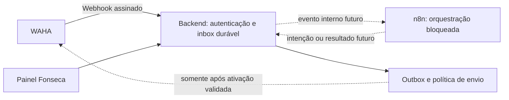

# n8n: esqueletos para revisão técnica

Estes arquivos são esqueletos JSON no formato de importação do n8n. **Não são workflows produtivos completos.** Não verificam eventos WAHA, não persistem filas, não processam conversas e não enviam mensagens. Foram preparados sem acessar n8n, WAHA, credenciais ou dados reais.

| Arquivo | Conteúdo executável | Estado entregue |
| --- | --- | --- |
| `n8n/ingress.backend-events.inactive.json` | Webhook interno → Stop And Error | Workflow inativo, Webhook desabilitado, Header Auth sem credencial, corpo bruto solicitado |
| `n8n/dispatch.inactive.json` | Manual Trigger → Stop And Error | Workflow inativo; toda execução manual termina no bloqueio |
| `n8n/validate-templates.mjs` | Verificação estática local dos dois JSON | Sem rede, imports no n8n ou alterações remotas |

Ambos têm `active: false`, guard incondicional habilitado imediatamente após o único gatilho e nenhuma saída posterior. Não contêm HTTP Request, Code, Execute Workflow, acesso a banco ou nodes WAHA. Não há URLs de serviços, referências a credenciais, valores secretos, destinatários nem dados fixados. As notas no canvas descrevem trabalho futuro, sem executá-lo.

O ingresso usa Webhook `typeVersion: 2`, `authentication: "headerAuth"`, `options.rawBody: true` e resposta `lastNode`. O código de resposta configurado é 503 caso exista conclusão normal, com corpo omitido; o Stop And Error interrompe a execução com falha. O status efetivo de uma falha depende do runtime e não foi testado. Não se promete uma resposta HTTP operacional deste esqueleto. Os nomes dos parâmetros e versões foram conferidos no [código oficial do Webhook](https://github.com/n8n-io/n8n/blob/master/packages/nodes-base/nodes/Webhook/Webhook.node.ts) e na [descrição oficial dos parâmetros](https://github.com/n8n-io/n8n/blob/master/packages/nodes-base/nodes/Webhook/description.ts), consultados em 30/10/2026.

## Fronteira técnica preservada

Esta proposta mantém os requisitos de inbox/outbox, deduplicação, consentimento, AppBarber e resultados ambíguos. A divisão atual concentra o acesso à API WAHA no backend. Um caminho direto n8n → WAHA não é implementado nem autorizado por este pacote. No projeto integrado, os templates ficam em `integrations/whatsapp/n8n/`; não foram importados em uma instalação.



Somente o backend resolve destinatários, conhece a chave da API WAHA e poderá alcançar sua API. O navegador fala apenas com o backend. O n8n não recebe segredo WAHA, segredo HMAC WAHA, sessão do navegador nem credencial do AppBarber. A disponibilidade visual de uma ação não concede permissão.

## Recepção futura: WAHA → backend → n8n

1. O backend recebe os bytes brutos com limites de tamanho e tipo. Verifica o HMAC SHA-512 e os cabeçalhos previstos pelo contrato da versão WAHA instalada, usando comparação em tempo constante, antes de interpretar o evento. Não serializa JSON novamente para calcular assinatura. HMAC não substitui proteção contra replay.
2. O receptor atribui ambiente, instância e tenant a partir de configuração confiável. Valida sessão e evento permitidos; preserva IDs como strings opacas e não transforma `@lid` em telefone. Mensagens próprias, grupos, mídia e tipos desconhecidos não geram respostas automáticas nesse primeiro escopo.
3. A inbox faz commit transacional com unicidade por `(environment, instance_id, session, provider_event_id)`. O efeito de processamento também deduplica por `(environment, instance_id, session, provider_message_id, handler_version)`. Eventos autenticados não suportados vão para quarentena durável.
4. O backend confirma recebimento ao WAHA somente após commit, inclusive para duplicata já persistida. Falha transitória de persistência permanece sem aceite; autenticação inválida não produz efeito de negócio. A resposta ao WAHA não depende de o n8n estar disponível.
5. Um consumidor futuro encaminha referência interna mínima ao n8n com credencial própria, contrato versionado e identidade derivada no servidor. O Webhook deste pacote representa apenas essa fronteira backend → n8n. Header Auth autentica o chamador interno; Raw Body apenas preserva a representação de entrada. Nenhum deles implementa a validação HMAC WAHA. A [documentação do Webhook](https://docs.n8n.io/integrations/builtin/core-nodes/n8n-nodes-base.webhook/) descreve essas opções e distingue URLs de teste e produção.

O normalizador deste pacote usa `fonseca.whatsapp.event.v2` (camelCase), separado do exemplo v1/snake_case do plano anterior. O callback interno deve passar por revisão de minimização e schema antes de encaminhamento ao n8n; enviar referência interna mínima em vez de repassar o corpo completo. Textos recebidos são dados não confiáveis: nunca selecionam credenciais, URLs, tenant, código ou ferramentas. Não adicionar node de IA, resposta automática ou ferramenta a partir deste esqueleto.

## Despacho futuro: backend como único emissor

O Manual Trigger não lê outbox e não solicita despacho. A outbox futura pertence ao backend e usa unicidade por `(environment, business_key)`, claim/lease atômico, prazo de validade, número limitado de tentativas e proteção contra conclusão por worker com lease antigo. A fila de execuções do n8n não substitui essa fila de negócio.

Imediatamente antes de cada tentativa, o backend revalida membership/capacidade, ambiente, destinatário autorizado, finalidade, consentimento atual, opt-out, pausa humana, responsável pelo envio, expiração e disponibilidade da sessão. Uma autorização anterior na criação do item não basta. O n8n pode futuramente solicitar uma intenção, mas o backend repete todas as verificações e deriva o escopo; não aceita papel ou tenant autodeclarado pelo callback.

Timeout após tentativa, perda de conexão depois do POST ou qualquer resultado ambíguo produz **UNKNOWN**. Não há repetição automática de um envio UNKNOWN. Reconciliar por ID/ACK quando possível; sem evidência conclusiva, encaminhar para revisão humana. Aceite HTTP não comprova entrega nem leitura. ACKs repetidos ou fora de ordem não criam mensagem e não rebaixam estado confirmado. Retentativas limitadas com backoff/jitter só são consideradas quando há evidência de que o envio não foi aceito; falhas de autenticação pausam o despacho.

AppBarber continua responsável por agenda, confirmações, lembretes, cancelamentos e campanhas vigentes. Toda finalidade sobreposta fica bloqueada neste caminho. Antes de qualquer migração, definir responsável exclusivo, corte autorizado, tratamento das pendências e rollback sem dois emissores simultâneos. A deduplicação local não deduplica envios independentes do AppBarber.

Opt-out revoga automações e cancela itens pendentes. Pedido ambíguo requer atendimento humano; mensagem recebida não autoriza campanhas e ausência de opt-out não comprova opt-in. O bloqueio precisa alcançar também a operação vigente do AppBarber por procedimento autorizado, enquanto não houver integração validada. Não se envia confirmação automática de opt-out nesta fase.

## Autenticação dos callbacks internos

As duas direções exigem credenciais separadas: backend → n8n e n8n → backend. Nenhuma está configurada aqui. A futura chamada de retorno usa identidade de serviço, escopo mínimo, destino fixo aprovado, TLS validado, autenticação verificável e proteção contra replay. Definir assinatura/corpo bruto, timestamp, nonce, expiração, rotação e revogação no contrato antes de implementar. Não reaproveitar a chave WAHA nem a sessão Auth de um usuário.

O backend valida schema, correlação, idempotência, versão, estado atual, tenant derivado e permissão de cada callback. Repetição idêntica é idempotente; correlação inexistente, mudança de escopo, estado incompatível ou resposta atrasada é rejeitada. ACK de transporte não é autorização para enfileirar ou enviar. Endpoints e schemas de callback ainda não estão definidos neste pacote.

## Revisão e validação disponíveis

Na raiz de `whatsapp-panel-package`:

```powershell
node n8n/validate-templates.mjs
```

A verificação lê e interpreta os JSON, confere workflow inativo, Webhook desabilitado, parâmetros de autenticação/corpo bruto, guard habilitado sem continue/retry, grafo único gatilho → bloqueio, ausência de credenciais e URLs, lista fechada de tipos de node, ausência de dados fixados e retenção desabilitada. O Stop And Error v1 é o node nativo para encerrar com erro; conferir a [referência oficial](https://docs.n8n.io/integrations/builtin/core-nodes/n8n-nodes-base.stopanderror/).

Os templates solicitam não salvar execuções manuais, sucesso, falha ou progresso. Isso é uma configuração de workflow, não prova de ausência de logs no proxy, runtime, histórico de versões ou infraestrutura. Conferir a política de retenção da instalação antes de tráfego real; as opções estão documentadas nas [configurações de workflow](https://docs.n8n.io/workflows/settings/).

É possível revisar os JSON no editor de uma instância de teste compatível mantendo tudo inativo, sem associar credenciais nem iniciar escuta. Não foi feita importação aqui. Compatibilidade da versão instalada, renderização do canvas, comportamento HTTP e retenção efetiva ainda não foram verificados. Um erro por credencial ausente no ingresso é esperado na preparação e não deve ser resolvido por remover a autenticação.

Antes de substituir estes esqueletos por workflows operacionais, implementar e testar com fixtures: assinatura válida/alterada; limites e escopo; duplicatas concorrentes; queda antes/depois do commit; recuperação de lease; atraso de callback; opt-out e pausa entre fila e envio; AppBarber como owner; isolamento de ambientes; timeout UNKNOWN sem retry; ACK fora de ordem; retenção e observabilidade sem conteúdo sensível. Esses testes de integração não foram executados e a preparação dos JSON não autoriza ativação, conexão de sessão ou envio real.
